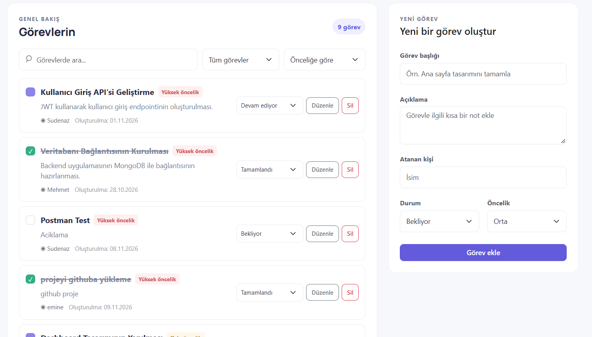

# TaskFlow Frontend

TaskFlow, görevleri listelemek ve yönetmek için React, Vite ve Bootstrap 5 ile
hazırlanmış bir web arayüzüdür. Görev verileri projedeki Express backend API'sinden
alınır.

## Özellikler

- Görevleri listeleme, ekleme, düzenleme ve silme
- Durum ve öncelik seçme, görev durumunu listeden güncelleme
- Görevlerde arama ve duruma göre filtreleme
- Başlığa, tarihe veya önceliğe göre sıralama
- Görev sayısı ve durum özetleri

## Gereksinimler

- Node.js ve npm
- TaskFlow backend'in çalışır durumda olması

## Yerel kurulum

Proje kök dizininden iki terminal aç.

İlk terminalde backend'i çalıştır:

```powershell
cd backend
npm install
npm run dev
```

İkinci terminalde frontend'i kurup başlat:

```powershell
cd frontend
npm install
Copy-Item .env.example .env
npm run dev
```

Frontend `http://localhost:5173`, backend ise `http://localhost:3000` adresinde
çalışır.

## Ekran Görüntüleri




